<!-- Cards in cards/ are generated by scripts/generate.mjs and refresh daily (.github/workflows/profile.yml). -->

  
  
  

  
  

  

  
  

<h3 align="center">Tools I build with</h3>

  

### Open-source contributions

<!-- contributions:start -->
**[eduardz1/mailstronaut](https://github.com/eduardz1/mailstronaut)** &nbsp;`22 merged`

- [Track live and synthetic acceptance for the five required providers](https://github.com/eduardz1/mailstronaut/pull/22)
- [Preserve pending draft edits while selecting an attachment](https://github.com/eduardz1/mailstronaut/pull/21)
- [Verify the combined native mailbox move and Undo workflows](https://github.com/eduardz1/mailstronaut/pull/20)
- [and 19 more](https://github.com/eduardz1/mailstronaut/pulls?q=is%3Apr%20author%3AHeavenlystorm)

**[akinware/gameport](https://github.com/akinware/gameport)** &nbsp;`5 merged`  
Native macOS app and CLI for running Windows games smoothly on Apple Silicon

- [Detect persistent black and unchanged game windows in the Lab](https://github.com/akinware/gameport/pull/5)
- [Guide game setup and Play, with Wine presets in Advanced](https://github.com/akinware/gameport/pull/4)
- [Import 774 CC0 community game recipes](https://github.com/akinware/gameport/pull/3)
- [and 2 more](https://github.com/akinware/gameport/pulls?q=is%3Apr%20author%3AHeavenlystorm)

**[HPIS-Holdings/app-store-compliance-checker](https://github.com/HPIS-Holdings/app-store-compliance-checker)** &nbsp;`2 open`  
Free, proof-only App Store & Google Play compliance checker: catch App Store rejections, privacy manifest…

- _open:_ [Refresh November Apple and Google policies and check dated console evidence](https://github.com/HPIS-Holdings/app-store-compliance-checker/pull/2)
- _open:_ [Expose policy sources and exact rule lookup in the CLI](https://github.com/HPIS-Holdings/app-store-compliance-checker/pull/1)

**[karnyadavdev/FontWizard](https://github.com/karnyadavdev/FontWizard)** &nbsp;`1 open`  
Safely change Windows 11 / 10 system fonts everywhere including all modern apps and third party apps

- _open:_ [Add Simplified and Traditional Chinese to the Font Wizard interface](https://github.com/karnyadavdev/FontWizard/pull/11)
<!-- contributions:end -->

 

<picture>
  <source media="(prefers-color-scheme: dark)" srcset="https://raw.githubusercontent.com/Heavenlystorm/Heavenlystorm/output/snake-dark.svg">
  <source media="(prefers-color-scheme: light)" srcset="https://raw.githubusercontent.com/Heavenlystorm/Heavenlystorm/output/snake-light.svg">
  
</picture>

